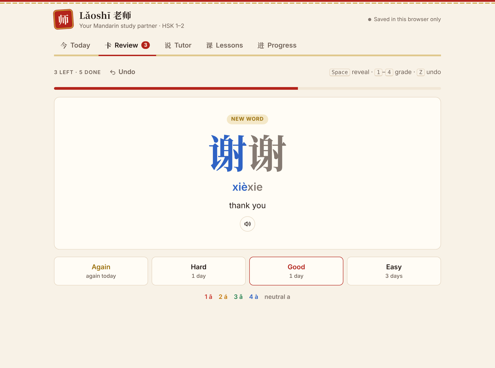
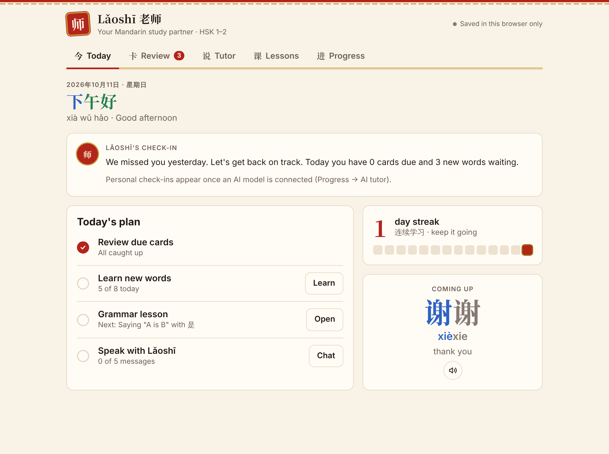
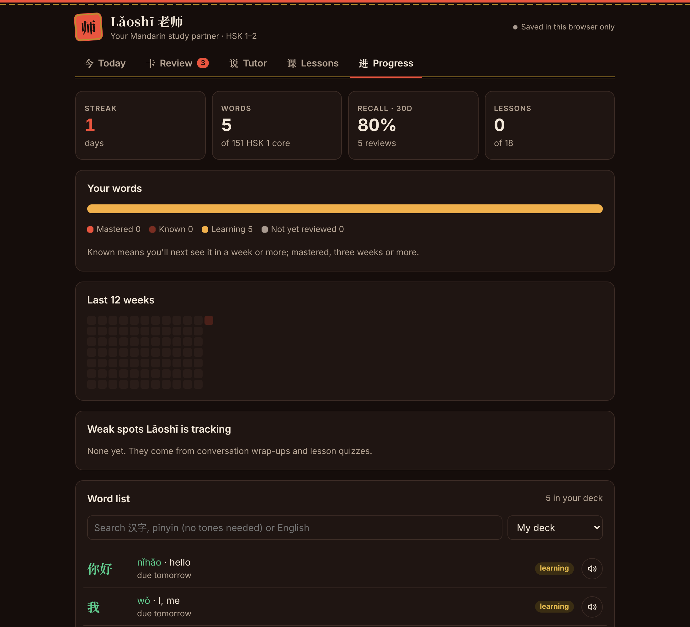
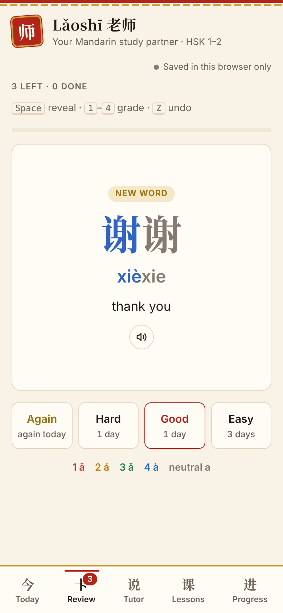

# Lǎoshī 老师 — an AI Mandarin study partner

A study app for beginner Mandarin (HSK 1–2) that combines spaced-repetition flashcards with an LLM-powered tutor. You practise conversation and it corrects your mistakes, writes grammar lessons on demand, and keeps track of your weak spots across sessions.

**[▶ Try the live demo](https://kaoi-cyber.github.io/laoshi/)** · a single HTML file, no build step, no backend.



## Features

**Flashcards with spaced repetition**
- A built-in deck of 151 core HSK 1 words, introduced a few new words per day
- An SM-2-style scheduler (Again / Hard / Good / Easy) that shows each next interval on its button
- Three card modes: characters → meaning, English → characters, and **listening → meaning** for tone practice
- Text-to-speech for every word, plus undo and keyboard shortcuts (`Space`, `1`–`4`, `Z`)
- Characters and pinyin are **coloured by tone** throughout the app

**AI conversation tutor**
- Role-play scenarios (ordering at a café, introducing yourself, shopping, …) or free chat
- You can write in characters, pinyin or English. The tutor replies in simple Chinese with pinyin and a translation, and **corrects your mistakes inline**
- Replies stream in token by token, and you can stop them at any time
- An optional "hide pinyin" mode blurs the pinyin and English so you have to read the characters (tap a line to reveal it)
- **Wrap up session** asks the model for a structured JSON summary. That summary adds new words to your deck, records weak spots, and updates private tutor notes that later sessions use for personalisation

**AI-written grammar lessons**
- 18 HSK 1–2 grammar points, each generated on demand as structured JSON: an explanation, the pattern, examples, a short reading and a quiz
- A low quiz score adds that grammar point to your weak spots

**Progress**
- Streak, a 12-week activity heatmap, recall rate and a breakdown of words by learning stage
- A searchable word list (search pinyin without tones: `nihao` finds 你好), and you can add your own words
- Export and import of your progress as a JSON file, plus light and dark themes

| Today | Progress (dark) | Mobile |
|---|---|---|
|  |  |  |

## Connecting a language model

The flashcards work fully offline. The tutor, lessons and daily check-ins need an LLM, which you set up under **Progress → AI tutor**:

| Provider | What you need | Notes |
|---|---|---|
| **Anthropic API** | An API key from [console.anthropic.com](https://console.anthropic.com) | Calls the Messages API straight from the browser (streaming). The default model is `claude-haiku-5-5`, and you can change it. |
| **Ollama (local, free)** | [Ollama](https://ollama.com) running on your machine | The default model is `qwen2.5:7b` (strong at Chinese). If you're using the hosted page rather than a local copy, start Ollama with `OLLAMA_ORIGINS="https://kaoi-cyber.github.io" ollama serve` so the browser is allowed to reach it. |

Your API key is stored only in your browser's `localStorage`, under a separate key from your study data. It is never included in exports and is sent only to the provider you choose.

When the page runs as a [Claude artifact](https://claude.ai), it uses the artifact runtime's built-in model access and per-user cloud storage instead, so you don't need a key there.

## How it works

Everything lives in [`index.html`](index.html): HTML, CSS and plain JavaScript, with no frameworks and no dependencies.

```
┌──────────── index.html ─────────────┐
│ Views: Today · Review · Tutor ·     │
│        Lessons · Progress           │
│                                     │
│ State (4 documents):                │
│   state  – settings, history, weak  │
│            spots, tutor notes       │
│   deck   – cards + SRS fields       │
│   chat   – conversation + summary   │
│   lessons– generated lessons, quiz  │
│        │                            │
│        ├─► localStorage (always)    │
│        └─► cloud doc store (when    │
│            running on claude.ai)    │
│                                     │
│ sample(prompt | messages, opts)     │
│   ├─ window.claude (claude.ai)      │
│   ├─ Anthropic Messages API (SSE)   │
│   └─ Ollama /api/chat (NDJSON)      │
└─────────────────────────────────────┘
```

A few design notes:

- **Prompting for structure.** The tutor's system prompt fixes a line-based reply format (`Correction:` / `中文:` / `Pinyin:` / `English:`). The UI parses this format as it streams in, so corrections are highlighted while the reply is still arriving. Lessons and session wrap-ups use JSON-only prompts, which are parsed defensively.
- **Memory without a vector database.** Each wrap-up has the model merge its notes on the learner into a short notes string (under 500 characters) plus a list of weak spots. Both are injected into later prompts, which gives the tutor long-term personalisation for a few hundred tokens.
- **Provider-agnostic sampling.** All three backends sit behind one `sample()` function with streaming callbacks, abort signals and typed error codes, so the rest of the app never needs to know which model it is talking to.
- **Scheduling.** `schedule(card, grade)` is a small SM-2 variant: each card has an ease factor (starting at 2.5, never below 1.3), lapses reset the interval to 0, and "Easy" gets a 1.3× bonus.

## Running it locally

```bash
git clone https://github.com/kaoi-cyber/laoshi.git
cd laoshi
python3 -m http.server 8000   # or just open index.html in a browser
```

Then open http://localhost:8000.

## Deploying to GitHub Pages

1. Push this repo to GitHub.
2. Go to **Settings → Pages → Build and deployment**, choose **Deploy from a branch**, then `main` / `/ (root)`.
3. After a minute the app is live at `https://kaoi-cyber.github.io/laoshi/`.

## Ideas for what's next

- Speech recognition for pronunciation practice, scored by tone
- Writing practice with stroke-order animations
- HSK 2–3 word decks
- Sync through a small backend (for example Supabase) instead of export/import

## License

[MIT](LICENSE)
